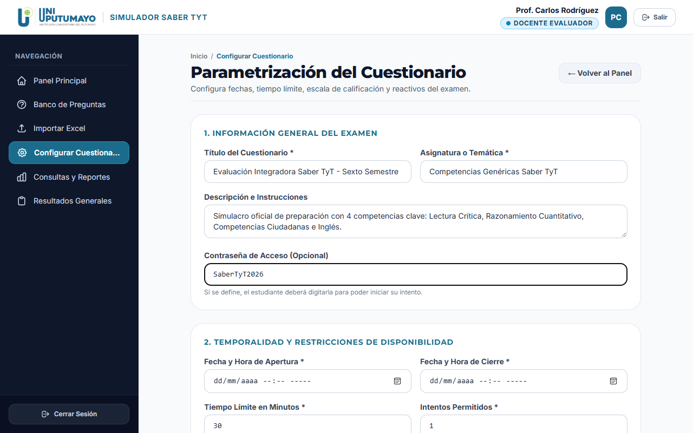
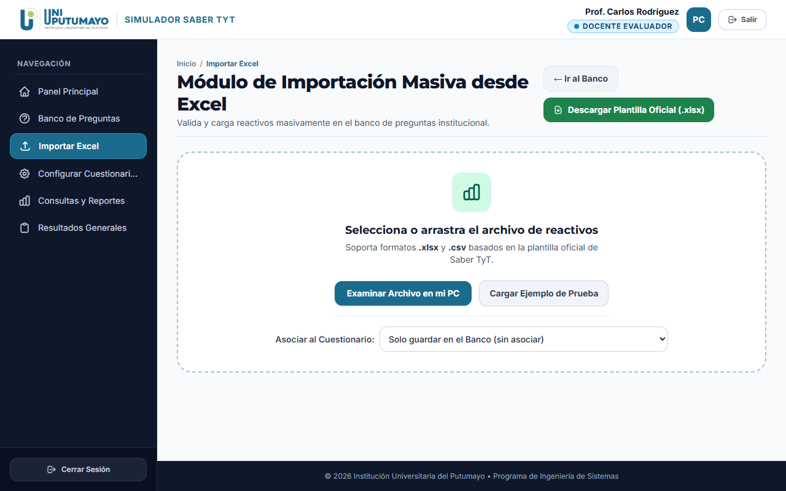
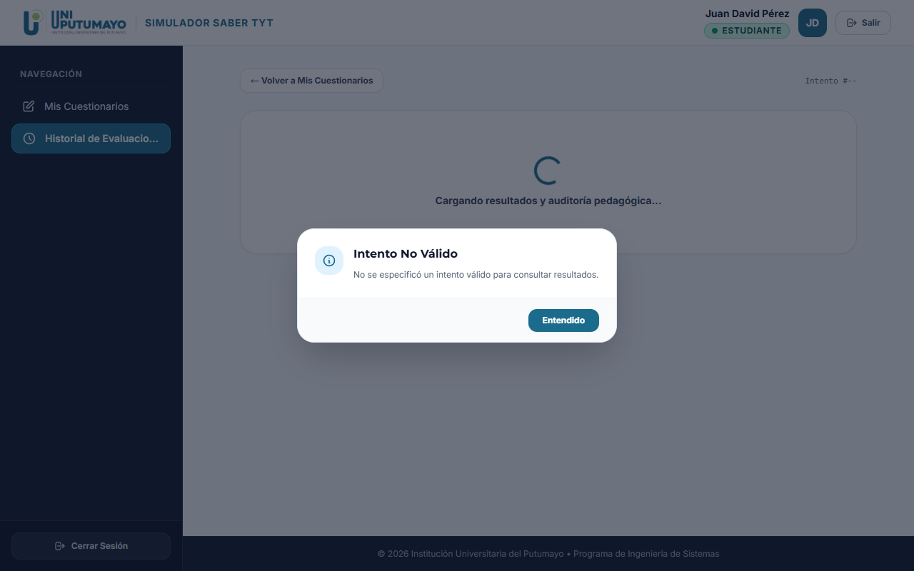

# 🎓 INSTITUCIÓN UNIVERSITARIA DEL PUTUMAYO
## Facultad de Ingeniería • Programa de Ingeniería de Sistemas (Sexto Semestre)
### Electiva Profesional III – Frameworks de Aplicaciones (Segundo Parcial Práctico • Unidad 2)
---
# 📋 INFORME DE PRUEBA FUNCIONAL DE EXTREMO A EXTREMO
### Proyecto Integrador: Simulador de Evaluaciones Saber TyT

- **Modalidad:** Trabajo en Grupos de Desarrollo Conformados
- **Fecha de Ejecución y Blindaje:** 13 de Noviembre de 2026
- **Socialización y Demostración Funcional en Vivo:** Sábado 14 de Noviembre de 2026
- **Repositorio Oficial:** [https://github.com/MP-Daniel/Simulador_Tyt.git](https://github.com/MP-Daniel/Simulador_Tyt.git)
- **Stack Oficial:** Django 4.2 + Python 3.13 + MySQL / SQLite + Tailwind CSS + JavaScript + SimpleJWT + OpenPyXL + ReportLab

---

## 1. 🎯 Propósito de la Actividad

Integrar y comprobar el funcionamiento comprobable de todo el simulador desde la perspectiva del **docente evaluador** y del **estudiante**, ejecutando un caso real completo de inicio a fin:
1. Crear una evaluación en estado inicial borrador con parametrización de temporalidad y contraseña.
2. Descargar la plantilla Excel oficial e importar masivamente preguntas con auditoría y validación fila por fila (Regla R10).
3. Habilitar la evaluación y comprobar el filtrado por disponibilidad para estudiantes (Regla R08).
4. Presentar el examen de forma cronometrada y segura sin fuga de respuestas correctas.
5. Calificar automáticamente con precisión decimal `DECIMAL(5,2)` y soporte de omitidas (Regla R09).
6. Analizar los resultados estadísticos, preguntas de mayor dificultad y desempeño por competencias Saber TyT.

---

## 2. 🧪 Matriz de Pruebas Funcionales Mínimas (Sección 4 del Taller)

| Caso de Prueba Obligatorio | Entrada / Condición Evaluada | Comportamiento Esperado | Resultado Obtenido en el Servidor | Estado | Incidencia Pendiente |
| :--- | :--- | :--- | :--- | :---: | :---: |
| **1. Archivo de plantilla correctamente diligenciado** | Plantilla `.xlsx` con columnas requeridas y 4 reactivos válidos asociados al cuestionario. | Importación exitosa; conteo y preguntas vinculadas correctos. | **HTTP 200 OK.** 4 preguntas válidas guardadas en BD; relación N:M `CuestionarioPregunta` creada exitosamente. | APROBADO | Ninguna |
| **2. Archivo con campos vacíos o respuesta distinta de A–D** | Archivo `.xlsx` con enunciado vacío, respuesta 'Z', clave 'X' en V/F y puntaje 0. | Rechazo o señalización del registro con mensaje comprensible. | **HTTP 400 Bad Request.** Se reportan las 4 filas con número exacto y causa; 0 registros corruptos insertados en BD. | APROBADO | Ninguna |
| **3. Fecha cerrada o evaluación inactiva** | Cuestionarios en estado `borrador`, `cerrado` o fuera de ventana temporal. | El estudiante no puede comenzar un nuevo intento. | Excluidos de `/api/cuestionarios/disponibles/`. Intento de acceso directo bloqueado con `DISPONIBILIDAD_BLOQUEADA`. | APROBADO | Ninguna |
| **4. Máximo de intentos alcanzado** | Estudiante intenta presentar un segundo intento en evaluación de 1 intento max. | El sistema bloquea un intento adicional. | **HTTP 400 Bad Request.** Mensaje del backend: *"Has alcanzado el límite de intentos permitidos (1/1)"*. | APROBADO | Ninguna |
| **5. Entrega de respuestas y cálculo** | Examen con 3 aciertos y 1 omitida. Re-envío duplicado posterior. | Se registra una sola entrega válida y la nota se calcula correctamente. | Persistencia en BD: Calificación **3.75 / 5.00** (`APROBADO`). Segundo POST responde intento ya finalizado (idempotente). | APROBADO | Ninguna |
| **6. Consulta docente y estadísticas** | Consulta de resultados globales por el docente de la evaluación. | Participantes, aprobados, reprobados y porcentajes coinciden con los registros. | Participantes: 1, Aprobados: 1 (100%), Reprobados: 0, Promedio: 3.75. Coincidencia exacta con la tabla `intentos`. | APROBADO | Ninguna |
| **7. Restricción por rol (RBAC)** | Estudiante intenta consultar reportes docentes o revisiones de otro estudiante. | Un estudiante no puede acceder a funciones o resultados privados del docente. | **HTTP 403 Forbidden** al consultar reportes docentes y **403 Forbidden** al intentar auditar intentos de otro alumno. | APROBADO | Ninguna |

---

## 3. 🚀 Recorrido del Escenario de Demostración Obligatoria (Pasos 20 al 26)

### Fase A. Acceso y Configuración Docente (Pasos 20 & 21)
1. **Inicio de Sesión:** Autenticación de `docente` con JWT.
2. **Validación Paramétrica:** El sistema rechazó mediante excepciones Django:
   - Cierre anterior o igual a la apertura (`cierre <= apertura` -> Regla R01).
   - Duración de respuesta no positiva (`tiempo_limite <= 0` -> Regla R04).
   - Intentos no positivos (`intentos_permitidos <= 0` -> Regla R04).
3. **Creación del Cuestionario:** Se configuró el cuestionario *"Evaluación Integradora Saber TyT - Sexto Semestre"*:
   - Asignatura / Temática: *Competencias Genéricas Saber TyT*.
   - Estado Inicial: `BORRADOR` (sin preguntas asignadas inicialmente).
   - Clave de Acceso: `SaberTyT2026`.
   - Límite de tiempo: 30 minutos | Intentos permitidos: 1 | Escala: 0.00 a 5.00 (Aprueba con 3.00).

### Fase B. Plantilla, Banco de Preguntas e Importación (Paso 22)
1. **Descarga de Plantilla Oficial:** Endpoint `/api/banco/descargar-plantilla/` genera un archivo `.xlsx` con dos hojas:
   - `Instrucciones`: Tabla con especificación detallada de cada columna, tipos permitidos y reglas de negocio.
   - `Plantilla_Preguntas`: Formato con las columnas `tematica`, `tipo`, `dificultad`, `texto_base`, `enunciado`, `opcion_a`, `opcion_b`, `opcion_c`, `opcion_d`, `respuesta_correcta`, `justificacion`, `puntaje`.
2. **Auditoría Fila por Fila (Regla R10):** Se probó la carga de un lote con 4 errores intencionales. El sistema devolvió HTTP 400 y detalló las filas rechazadas sin tocar la base de datos.
3. **Carga Exitosa y Vinculación N:M:** Se importaron 4 reactivos de las 4 competencias Saber TyT vinculados directamente al cuestionario creado.

### Fase C. Publicación y Presentación del Estudiante (Pasos 23 & 24)
1. **Publicación:** El docente cambia el estado de `borrador` a `disponible` tras verificar que cuenta con preguntas.
2. **Cierre de Sesión:** Cierre de la cuenta docente.
3. **Acceso del Estudiante:** Inicio de sesión con la cuenta `estudiante1` (Juan David Pérez).
4. **Validación de Disponibilidad (Regla R08):** Solo aparecen las evaluaciones activas y dentro del rango de fechas.
5. **Validación de Contraseña de Acceso:** Se intenta ingresar sin contraseña (rechazado) y con contraseña incorrecta (rechazado). Al suministrar `SaberTyT2026`, se inicia el examen.
6. **Sala de Examen en Vivo:**
   - Temporizador regresivo en vivo de 30 minutos.
   - Reactivos seguros: payload protegido sin clave correcta ni retroalimentación.
7. **Entrega Persistente:**
   - 3 respuestas correctas seleccionadas.
   - 1 pregunta intencionalmente omitida (Regla R09).
   - Envío confirmado y calificado: **3.75 / 5.00** (`APROBADO`).
8. **Blindaje de Cupo:** El estudiante intenta presentar un segundo intento y es bloqueado por el servidor (1/1 intentos alcanzados).
9. **Revisión Pedagógica:** El estudiante consulta su revisión con retroalimentaciones y claves formativas habilitadas.
10. **Aislamiento de Datos:** La cuenta `estudiante2` intenta acceder a la revisión de `estudiante1` y recibe **HTTP 403 Forbidden**.

### Fase D. Consultas, Resultados y Análisis Docente (Pasos 25 & 26)
1. **Reingreso Docente:** El docente evaluador consulta el panel de supervisión.
2. **Consolidado de Participantes:** Registro único de `estudiante1` con calificación 3.75 y estado APROBADO.
3. **Resumen Estadístico (KPIs):** 1 estudiante, 1 aprobado (100%), 0 reprobados, promedio general 3.75.
4. **Análisis de Dificultad por Reactivo:** Clasificación de preguntas según aciertos y errores.
5. **Análisis por Eje Temático:** Desempeño por competencia Saber TyT.
6. **Invarianza Matemática:** Los registros de la tabla `respuestas_intento` sustentan de forma exacta la calificación del intento.

---

## 4. 👥 Cuentas de Acceso para la Demostración

| Usuario | Contraseña | Rol Asignado | Rol en la Socialización |
| :--- | :--- | :--- | :--- |
| `docente` | `docente123` | **Docente Evaluador** | Creación de evaluación, parametrización, importación masiva y análisis de resultados. |
| `estudiante1` | `estudiante123` | **Estudiante** | Presentación de examen, validación de contraseña de ingreso, temporizador y entrega. |
| `estudiante2` | `estudiante123` | **Estudiante** | Demostración de aislamiento de notas (bloqueo 403 al intentar auditar intento ajeno). |
| `admin` | `admin123` | **Administrador** | Supervisión global, modo Sandbox, gestión de roles y reportes institucionales. |

---

## 5. 📸 Evidencias en Capturas de Pantalla (Punto 5 del Taller)

Conforme a las exigencias oficiales de la **Sección 5 de la Guía de Actividad** (*Evidencias y producto de entrega*), se documenta visualmente cada hito funcional indispensable:

### 1. Configuración Docente (Creación de Cuestionario, Vigencia y Contraseña)
Configuración de título, asignatura, descripción, ventana temporal (apertura y cierre), duración de 30 minutos, 1 intento máximo y clave de acceso `SaberTyT2026`:

### 2. Banco de Preguntas y Descarga de Plantilla Oficial Excel
Repositorio central de reactivos clasificados por competencias genéricas Saber TyT, nivel de dificultad (Baja/Media/Alta) y botón de descarga de la plantilla oficial multi-hoja `.xlsx`:

### 3. Módulo de Importación Masiva Excel y Auditoría Preventiva
Zona de carga drag-and-drop con validación previa de reglas de negocio (R02, R05, R06, R10), diagnóstico de errores fila por fila y auditoría antes de persistir:

### 4. Portal del Estudiante y Evaluación Activa (Disponibilidad y Clave)
Panel del estudiante con visibilidad exclusiva de cuestionarios habilitados en estado `disponible`, indicador de contraseña requerida y vigencia activa:

### 5. Sala de Examen en Vivo (Temporizador Regresivo y Opciones A-D)
Interfaz del estudiante con temporizador dinámico sincronizado, panel lateral de seguimiento de reactivos y opciones de selección múltiple protegidas:

### 6. Resultados y Calificación Inmediata con Retroalimentación Pedagógica
Cálculo decimal exacto de la nota (3.75 / 5.00), estado APROBADO, desglose de aciertos (3) y omitidas (1), con justificaciones formativas para cada reactivo:

### 7. Panel Docente de Supervisión y Reportes Estadísticos Saber TyT
Auditoría y analítica académica: tasa de aprobación (100%), promedio de notas, distribución de intentos, preguntas críticas y análisis de desempeño por ejes temáticos:

---

## 6. 📂 Entregables Disponibles en el Repositorio

1. **Documento PDF Oficial:** [`INFORME_PRUEBA_FUNCIONAL_EXTREMO_A_EXTREMO.pdf`](./INFORME_PRUEBA_FUNCIONAL_EXTREMO_A_EXTREMO.pdf) (Documento con membrete oficial UniPutumayo, tablas de validación, capturas visuales de evidencias y KPIs).
2. **Directorio de Evidencias:** Carpeta [`docs/evidencias/`](./docs/evidencias/) con las 7 capturas de pantalla en alta resolución.
3. **Suite de Verificación del Taller:** [`test_taller_extremo_a_extremo.py`](./test_taller_extremo_a_extremo.py) (Comprueba de forma desatendida las 4 fases, 26 pasos y 7 pruebas mínimas).
4. **Suite de Seguridad y JWT:** [`test_jwt_security.py`](./test_jwt_security.py) (14 pruebas de seguridad, roles, Sandbox y blindaje de endpoints).
5. **Suite de Reportes y Excel:** [`test_reportes_excel.py`](./test_reportes_excel.py) (14 pruebas de consultas jerárquicas y exportación `.xlsx`).
6. **Servidor y Código Fuente:** Aplicaciones desacopladas `authentication`, `banco_preguntas`, `cuestionarios`, `evaluaciones` y `reportes`.
