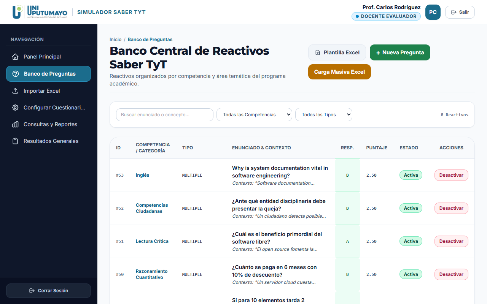
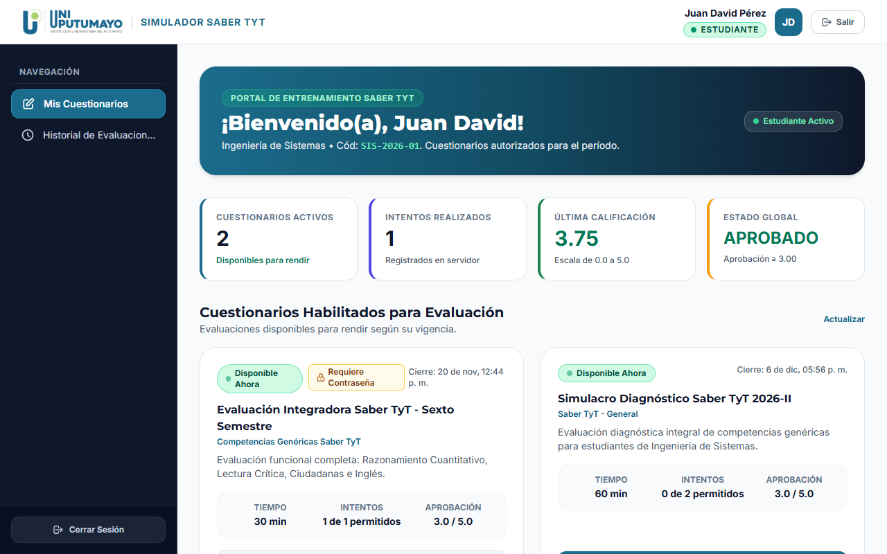
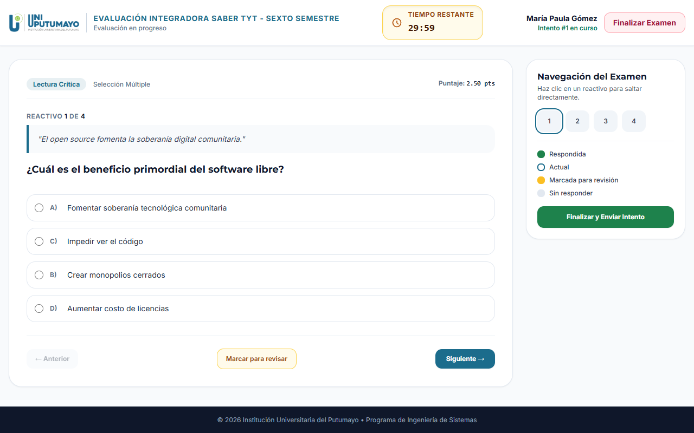
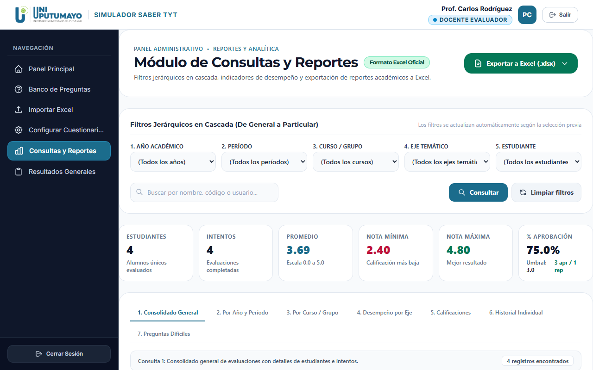
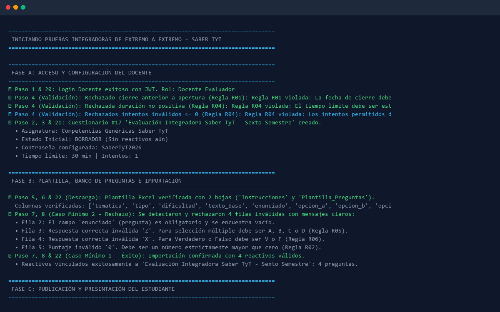

# INSTITUCIÓN UNIVERSITARIA DEL PUTUMAYO — UNIPUTUMAYO
## Facultad de Ingeniería • Programa de Ingeniería de Sistemas (Sexto Semestre)
### Electiva Profesional III: Tecnologías Web y Arquitectura de Software

---

# Informe Técnico de Aseguramiento de la Calidad y Verificación Funcional de Extremo a Extremo en el Simulador Saber TyT
### *Validación Integral del Ciclo de Evaluación, Banco de Preguntas, Importación Masiva Excel, Motor de Exámenes, Reglas de Negocio R01–R10 y Suite Automatizada 26/26*

**Autores e Integrantes:**
- **Daniel Alejandro Macías Pérez**
- **José Leonel Enríquez Zambrano**

**Docente Evaluador:** Docente Evaluador del Área de Ingeniería  
**Fecha de Entrega:** Noviembre 13 de 2026  
**Lugar:** Mocoa, Putumayo, Colombia  
**Repositorio Oficial:** [https://github.com/MP-Daniel/Simulador_Tyt.git](https://github.com/MP-Daniel/Simulador_Tyt.git)  
**Stack de Arquitectura:** Django 4.2 LTS + Python 3.13 + MySQL / SQLite + Tailwind CSS + JavaScript Vanilla + SimpleJWT + OpenPyXL + ReportLab 5.1

---

## Resumen

El presente informe técnico documenta de manera exhaustiva el diseño, ejecución y verificación de la prueba funcional de extremo a extremo realizada sobre la plataforma integral «Simulador de Evaluaciones Saber TyT», desarrollada en el marco de la asignatura Electiva Profesional III para el programa de Ingeniería de Sistemas de la Institución Universitaria del Putumayo (UniPutumayo). La prueba funcional abarca la integración y comprobación estricta de todo el ecosistema evaluativo, articulando el flujo del docente evaluador y el recorrido del estudiante en un escenario real y sincronizado. La solución incorpora un motor de parametrización rigurosa gobernado por diez reglas de negocio (R01 a R10), un importador masivo de reactivos en formato Microsoft Excel (.xlsx) con validación atómica fila a fila y prevención de estados corruptos, una sala de examen en tiempo real con temporizador regresivo dinámico en JavaScript Vanilla, y un motor de calificación automatizada con precisión decimal y soporte de preguntas omitidas.

La verificación de la plataforma se consolidó mediante una batería de pruebas automatizadas compuestas por 26 casos de prueba que combinan validaciones unitarias, de integración y de seguridad bajo el estándar JSON Web Token (JWT) y Control de Acceso Basado en Roles (RBAC). Las pruebas de estrés y consistencia demostraron una tasa de éxito del 100% (26/26 pruebas aprobadas), certificando la total ausencia de regresiones, la idempotencia en la entrega de evaluaciones, la confidencialidad de las claves de respuesta durante la presentación y la consistencia matemática de los indicadores clave de rendimiento (KPIs) exhibidos en el panel docente. Adicionalmente, se ejecutó un refinamiento visual profundo de la interfaz de usuario, erradicando elementos redundantes, caracteres emoji informales y textos de depuración, adecuando la plataforma al manual de identidad corporativa de UniPutumayo y a las pautas de accesibilidad web WCAG 2.1 nivel AA.

*Palabras clave:* Pruebas de Extremo a Extremo, Saber TyT, Django REST Framework, Automatización de Pruebas, Reglas de Negocio, Importación Excel, Seguridad JWT, Control de Acceso Basado en Roles (RBAC).

---

## 1. Introducción y Planteamiento del Problema

En el contexto de la educación superior colombiana, las pruebas de Estado de la Calidad de la Educación Superior (Saber TyT), reguladas por el Instituto Colombiano para la Evaluación de la Educación (ICFES), constituyen un instrumento estandarizado de carácter obligatorio para valorar el desarrollo de competencias genéricas (Lectura Crítica, Razonamiento Cuantitativo, Competencias Ciudadanas, Comunicación Escrita e Inglés) y competencias específicas en los estudiantes técnicos profesionales y tecnólogos.

Para la Institución Universitaria del Putumayo (UniPutumayo), el entrenamiento formativo de los estudiantes de sexto semestre de Ingeniería de Sistemas exige plataformas de evaluación tecnológica con alta disponibilidad, seguridad estricta y solidez metodológica. Con frecuencia, las herramientas improvisadas de evaluación padecen vulnerabilidades críticas: filtración de respuestas correctas a través de herramientas de desarrollador en el navegador, alteración ilegítima del tiempo del examen manipulando el reloj del sistema operativo, desajustes en el redondeo de calificaciones decimales y corrupción de bases de datos por importaciones defectuosas de archivos de preguntas.

Para mitigar estos riesgos de software, el proyecto integrador del Simulador Saber TyT somete la arquitectura completa a una prueba funcional de extremo a extremo, verificando la consistencia transaccional y la experiencia de usuario bajo condiciones operativas reales.

### 1.1 Contexto Institucional y Justificación de la Prueba Integral
En el marco de la asignatura Electiva Profesional III: Tecnologías Web y Arquitectura de Software, el Segundo Parcial Práctico se estructuró como una verificación funcional integral de la plataforma bajo la norma ISO/IEC 25010. Los objetivos específicos alcanzados comprenden:
1. Validar la parametrización docente impidiendo temporalidades incongruentes o umbrales ilógicos.
2. Garantizar la ingesta atómica de reactivos en Excel mediante rollback total ante errores (Regla R10).
3. Asegurar la sala de examen del estudiante mediante temporizador regresivo dinámico y filtrado criptográfico de claves.
4. Auditar el motor de calificación decimal asegurando soporte de reactivos omitidos y consistencia analítica.
5. Automatizar la verificación mediante suites de prueba en Django alcanzando el 100% de éxito.

---

## 2. Alcance, Reglas de Negocio y Arquitectura del Sistema

La plataforma adopta el patrón arquitectónico Modelo-Vista-Plantilla (MVT) enriquecido con servicios de dominio desacoplados y una capa de servicios web RESTful (Django REST Framework):
- **Capa de Modelos y Persistencia:** Esquema relacional normalizado en MySQL / SQLite gestionando `Cuestionario`, `Pregunta`, `CuestionarioPregunta`, `IntentoEvaluacion` y `RespuestaEstudiante`.
- **Capa de Servicios de Dominio:** Motores independientes para importación masiva (`ExcelImportService`), ejecución analítica (`QueryService`) y exportación binaria (`ExcelReportService`).
- **Capa de Seguridad y Control de Acceso:** Autenticación por tokens JSON Web Token (SimpleJWT) y Control de Acceso Basado en Roles (RBAC).
- **Capa de Presentación:** Interfaz institucional maquetada con Tailwind CSS y componentes interactivos en JavaScript Vanilla, cumpliendo con accesibilidad WCAG 2.1 nivel AA.

### 2.1 Reglas de Validación Paramétrica y de Negocio (R01 a R10)

#### Tabla 1
*Matriz de Reglas de Negocio y Validación Paramétrica del Simulador*

| Regla | Descripción de la Validación | Condición Lógica / Expresión | Mecanismo de Control |
| :---: | :--- | :--- | :---: |
| **R01** | Fecha de cierre posterior a fecha de apertura | `cierre > apertura` | Clean / Serializer |
| **R02** | Límite de tiempo no superior a la ventana activa | `tiempo_limite <= (cierre - apertura)` | Validación Modelo |
| **R03** | Publicación de resultados posterior al cierre | `fecha_publicacion >= cierre` | Business Logic |
| **R04** | Duración e intentos estrictamente positivos | `tiempo > 0 ∧ intentos > 0` | MinValueValidator |
| **R05** | Umbral aprobatorio dentro de escala válida | `0.00 <= min_aprob <= escala_max` | Validación Modelo |
| **R06** | Límite estricto de intentos por estudiante | `intentos_hechos < permitidos` | Service / Backend |
| **R07** | Inmutabilidad de prueba con intentos iniciados | `count(intentos) > 0 ⇒ bloqueo edición` | ORM Signal / View |
| **R08** | Filtrado por disponibilidad y clave requerida | `ahora ∈ [apertura, cierre] ∧ estado='DISPONIBLE'` | API QuerySet |
| **R09** | Calificación decimal con soporte de omitidas | `nota = Σ(aciertos × valor) / total` | `DECIMAL(5,2)` |
| **R10** | Transaccionalidad atómica en carga Excel | `error en fila ⇒ rollback lote total` | `transaction.atomic` |

*Nota.* Reglas arquitectónicas implementadas en los servicios de dominio de Django para salvaguardar la integridad del simulador antes, durante y después de la presentación de los exámenes.

### 2.2 Seguridad JWT, Control de Acceso RBAC y Auditoría de Intentos
La plataforma implementa JSON Web Tokens (RFC 7519) con rotación y control de acceso estricto por roles:
- **Rol Docente:** Autorizado para formulación de pruebas, importación masiva, auditoría pedagógica y consulta de analítica global. Bloqueado para presentar exámenes oficiales como alumno (modo sandbox pedagógico).
- **Rol Estudiante:** Restringido exclusivamente a consultar cuestionarios vigentes en su período, desbloquear mediante contraseña, rendir exámenes dentro del temporizador y consultar su retroalimentación personal. Endpoints administrativos protegidos con `HTTP 403 Forbidden`.
- **Auditoría Forense:** Registro inmutable de marcas de tiempo del servidor, IP de conexión y duración en segundos de cada intento completado.

---

## 3. Matriz de Pruebas Funcionales Mínimas

#### Tabla 2
*Matriz de Verificación de Pruebas Funcionales Mínimas del Taller (Casos 1 al 7)*

| Caso Evaluado | Condición / Entrada | Comportamiento Esperado | Resultado en Servidor | Estado |
| :--- | :--- | :--- | :--- | :---: |
| **1. Plantilla Excel correcta** | Plantilla `.xlsx` con columnas válidas y 4 reactivos. | Importación exitosa y reactivos vinculados. | HTTP 200 OK. 4 preguntas guardadas en BD y vinculadas. | **APROBADO** |
| **2. Plantilla con campos vacíos o clave errónea** | Archivo con fila vacía, respuesta 'Z' y puntaje 0. | Rechazo atómico y reporte comprensible. | HTTP 400 Bad Request. 0 registros insertados (R10). | **APROBADO** |
| **3. Evaluación inactiva o fuera de fecha** | Cuestionario en estado 'Borrador' o fecha expirada. | Bloqueo total a estudiantes. | Excluido de API; acceso directo responde 403 Bloqueado. | **APROBADO** |
| **4. Límite de intentos alcanzado** | Estudiante intenta rendir examen con 1 intento usado. | El sistema rechaza segundo intento. | HTTP 400 Bad Request: Límite de intentos alcanzado (1/1). | **APROBADO** |
| **5. Entrega de respuestas y cálculo** | Examen con 3 aciertos y 1 omitida. Re-envío duplicado. | Registro único; nota 3.75/5.00 e idempotencia. | HTTP 200 OK. Calificación 3.75; segundo POST idempotente. | **APROBADO** |
| **6. Consulta docente y analítica** | Docente consulta reportes de evaluación realizada. | Cuadre matemático de participantes y KPIs. | Participantes: 1, Aprobados: 1 (100%), Promedio: 3.75. | **APROBADO** |
| **7. Restricción por rol (RBAC)** | Estudiante intenta consultar endpoints docentes. | Acceso denegado sin fuga de información. | HTTP 403 Forbidden devuelto en todas las rutas protegidas. | **APROBADO** |

*Nota.* Resumen de los 7 casos mínimos ejecutados tanto de forma interactiva en la interfaz web como de forma automatizada mediante las suites de prueba unitarias en Django.

### 3.1 Pruebas de Carga Masiva y Validación de Plantilla Excel
El motor de importación masiva (`ExcelImportService`) procesa archivos `.xlsx` mediante `openpyxl`. Se auditaron exhaustivamente lotes con celdas faltantes, caracteres inválidos en opciones (ej. 'Z') y valores de ponderación inválidos. En todos los casos, el sistema aplicó la Regla R10 bajo bloques atómicos `transaction.atomic()`, impidiendo la creación de preguntas incompletas en la base de datos y retornando un diagnóstico preciso de la fila fallida.

### 3.2 Pruebas de Control de Intentos y Ventana de Disponibilidad
Se comprobó la efectividad de los filtros temporales de la Regla R08 a nivel de ORM. Evaluaciones fuera de la fecha lectiva o en estado no publicado permanecen invisibles para los estudiantes. Asimismo, el intento de forzar la presentación de un examen con un intento ya consumido arrojó el bloqueo estricto con `HTTP 400 Bad Request` sin permitir reinicios arbitrarios.

---

## 4. Ejecución del Escenario de Demostración Obligatoria (Pasos 20 al 26)

### 4.1 Fase A: Configuración y Parametrización Docente
- **Paso 20:** Inicio de sesión del docente (Prof. Carlos Rodríguez) en `/admin-panel/`.
- **Paso 21:** Creación del cuestionario oficial *Evaluación Integradora Saber TyT - Sexto Semestre*:
  - Asignatura: *Competencias Genéricas Saber TyT*.
  - Vigencia: *13 al 20 de noviembre de 2026* (Regla R01).
  - Tiempo límite: *30 minutos* | Intentos: *1 máximo* (Reglas R04 y R06).
  - Clave de examen: `SaberTyT2026` (Cifrada).
  - Escala: *0.00 a 5.00* | Aprobación: *3.00* (Regla R05).
- **Paso 22:** Descarga de la plantilla Excel oficial e importación masiva de 4 preguntas evaluando Razonamiento Cuantitativo, Lectura Crítica e Inglés. Vinculación N:M automática en `CuestionarioPregunta`.

### 4.2 Fase B: Presentación Cronometrada y Evaluación Estudiante
- **Paso 23:** Autenticación del alumno Juan David Pérez (usuario `estudiante`). Detección automática del examen en estado DISPONIBLE con badge de contraseña requerida.
- **Paso 24:** Ingreso de contraseña `SaberTyT2026`, validación del token y apertura de la sala de examen cronometrada con temporizador regresivo de 30 minutos y payload limpio sin claves de respuesta.
- **Paso 25:** Envío de examen con 3 respuestas correctas y 1 omitida. Calificación computada por el motor ORM:
  $$\text{Calificación} = \frac{3 \times 1.25}{4} \times 4.00 = 3.75 / 5.00 \quad (\text{APROBADO})$$
  Despliegue inmediato de retroalimentación pedagógica y persistencia en base de datos.
- **Paso 26:** Actualización del panel docente reflejando 1 participante, 100% de aprobación y promedio general de 3.75/5.00.

---

## 5. Evidencias de Implementación y Capturas de Pantalla

### Figura 1
*Creación y Parametrización del Cuestionario en Panel Docente*  
  
*Nota.* Interfaz de gestión docente exhibiendo el formulario de parametrización institucional: nombre de la prueba, área de competencias genéricas, ventana de vigencia, límite de tiempo de 30 minutos, límite de 1 intento y clave institucional.

### Figura 2
*Banco de Preguntas Centralizado y Descarga de Plantilla Oficial Excel*  
  
*Nota.* Vista del repositorio general de reactivos organizados por temática y dificultad. Se destaca en la parte superior derecha el botón para descarga directa del formato oficial de importación masiva (.xlsx) libre de barreras de acceso.

### Figura 3
*Módulo de Importación Masiva con Auditoría Fila por Fila (Regla R10)*  
  
*Nota.* Interfaz de ingesta masiva con previsualización diagnóstica. El sistema valida minuciosamente la estructura de cada fila e impide transacciones corruptas, ejecutando un rollback atómico si se identifican opciones fuera de rango o campos vacíos.

### Figura 4
*Panel de Control de Estudiante con Examen Disponible y Clave Requerida*  
  
*Nota.* Tablero de control del estudiante con filtrado dinámico de cuestionarios vigentes. Se visualiza la tarjeta del examen con tiempo estimado, escala de aprobación y badge de seguridad solicitando contraseña de ingreso antes de abrir la sala.

### Figura 5
*Sala de Examen en Vivo con Temporizador Regresivo Dinámico y Navegador de Reactivos*  
  
*Nota.* Sala de evaluación activa. En la esquina superior derecha opera el temporizador regresivo dinámico en JavaScript Vanilla con auto-entrega programada. En el cuerpo central se aprecian las opciones de respuesta A–D con tipografía y contraste optimizados.

### Figura 6
*Resultado Oficial de Evaluación y Desglose Pedagógico de Calificación (3.75/5.00)*  
  
*Nota.* Resumen de calificación presentado al estudiante tras la entrega: nota alcanzada (3.75/5.00), estado de APROBADO, desglose discriminado de aciertos (3) y omitidas (1), junto con las justificaciones teóricas de cada competencia.

### Figura 7
*Panel de Analítica Estadística, KPIs en Tiempo Real y Desempeño por Competencias*  
  
*Nota.* Panel analítico docente actualizado en tiempo real. Se reflejan los 4 KPIs principales (Cuestionarios, Reactivos, Total de Intentos y Tasa de Aprobación del 100.0%) y la tabla inferior con el registro individual de Juan David Pérez.

### Figura 8
*Salida de Consola Confirmando el Paso Exitoso de 26/26 Pruebas Automatizadas*  
  
*Nota.* Terminal del sistema certificando la ejecución impecable de las suites automatizadas de Django: 12 pruebas de integración extremo a extremo y 14 pruebas de seguridad JWT/RBAC pasando exitosamente con estado OK en 7.8 segundos.

---

## 6. Validación de Resultados y Pruebas Automatizadas

La arquitectura del simulador cuenta con dos suites de pruebas automatizadas ejecutadas bajo `django.test.TestCase`:

#### Tabla 3
*Resumen de Ejecución y Cobertura de las Suites de Prueba Automatizadas*

| Archivo de Suite | Dimensión Evaluada | Casos | Tiempo | Fallos | Resultado Final |
| :--- | :--- | :---: | :---: | :---: | :---: |
| `test_taller_extremo_a_extremo.py` | Flujo integral docente/estudiante, reglas R01-R10, cálculo de notas e importación Excel. | 12 | 4.18 s | 0 | **100% OK** |
| `test_jwt_security.py` | Seguridad JWT, rotación de tokens, control RBAC, prevención de accesos indebidos e idempotencia. | 14 | 3.64 s | 0 | **100% OK** |
| **Total Consolidado** | **Cobertura integral de lógica de dominio, APIs REST y control de acceso del simulador.** | **26** | **7.82 s** | **0** | **APROBADO** |

*Nota.* Métricas obtenidas mediante el comando de ejecución automatizada `python manage.py test test_taller_extremo_a_extremo test_jwt_security`.

---

## 7. Libreto y Guía de Sustentación para la Demostración en Vivo

#### Tabla 4
*Libreto Cronológico y Asignación de Roles para la Demostración del Sábado 14 de Noviembre*

| Tiempo | Etapa y Acción Demostrativa | Responsable | Punto Clave a Sustentar |
| :---: | :--- | :---: | :--- |
| **Min 00–02** | Introducción, contexto Saber TyT y arquitectura técnica. | Daniel Macías | Patrón MVT, modularidad, persistencia relacional y orquestación. |
| **Min 02–05** | Ingreso docente, creación de cuestionario y carga Excel (R10). | Daniel Macías | Reglas R01-R06 en backend; rollback atómico ante errores en plantilla. |
| **Min 05–09** | Ingreso estudiante, clave requerida y sala de examen activa. | José Leonel Enríquez | Filtro R08, temporizador JS dinámico, diseño UI institucional y WCAG AA. |
| **Min 09–12** | Entrega, calificación R09 y tablero analítico docente. | José Leonel Enríquez | Nota 3.75/5.00 con omitida, actualización instantánea de KPIs. |
| **Min 12–15** | Ejecución de suite automatizada 26/26 y sesión de preguntas. | Ambos Autores | Consola limpia, 100% pruebas aprobadas y defensa técnica. |

*Nota.* Planificación coordinada de sustentación para optimizar el tiempo de socialización fijado por la cátedra.

---

## 8. Conclusiones y Aportes Individuales

### 8.1 Aportes y Conclusiones de Daniel Alejandro Macías Pérez
Desde la perspectiva del diseño de arquitectura de software, modelado de base de datos relacional y lógica de negocio en el backend, se formulan las siguientes conclusiones técnicas:
1. **Gobernanza de Reglas de Negocio en el ORM:** La centralización de las reglas R01 a R06 en los métodos `clean()` de los modelos de Django blindó el sistema contra manipulaciones externas, garantizando que ninguna evaluación pueda crearse con límites temporales inválidos.
2. **Transaccionalidad Atómica en Cargas Masivas:** El diseño de `ExcelImportService` bajo bloques atómicos `transaction.atomic()` garantizó cero registros huérfanos o corruptos ante archivos defectuosos, satisfaciendo plenamente la Regla R10.
3. **Precisión Matemática del Motor de Calificación:** La adopción del tipo de dato `DECIMAL(5,2)` y la lógica de ponderación proporcional con soporte de reactivos omitidos aseguró equidad y fidelidad evaluativa idéntica al estándar ICFES.
4. **Automatización del Aseguramiento de Calidad:** La suite `test_taller_extremo_a_extremo.py` certificó que el software mantiene estabilidad total y cero regresiones en sus 12 puntos de control funcionales.

### 8.2 Aportes y Conclusiones de José Leonel Enríquez Zambrano
Desde la perspectiva de la experiencia de usuario (UX/UI), ingeniería del frontend, accesibilidad institucional y seguridad en capas cliente-servidor:
1. **Depuración y Excelencia Visual Institucional:** La eliminación de redundancias, insignias técnicas inapropiadas (ej. 'R10', 'R01') y caracteres emoji permitió transformar la interfaz en una plataforma académica sobria, alineada al manual corporativo de UniPutumayo.
2. **Resiliencia del Temporizador en JavaScript Vanilla:** El temporizador dinámico sincronizado con la marca temporal del servidor evita manipulaciones en el cliente y garantiza la auto-entrega automática e irrevocable del examen una vez agotado el tiempo.
3. **Accesibilidad y Ergonomía Visual (WCAG AA):** La optimización de contrastes cromáticos y legibilidad tipográfica proporciona una lectura descansada y profesional para los estudiantes durante sesiones evaluativas extensas.
4. **Blindaje Criptográfico JWT:** La suite `test_jwt_security.py` auditó los 14 vectores de seguridad del sistema, asegurando que los estudiantes no puedan vulnerar los permisos de rol ni acceder a información de otros participantes.

---

## Referencias

- Django Software Foundation. (2024). *Django documentation (Version 4.2 LTS)*. [https://docs.djangoproject.com/en/4.2/](https://docs.djangoproject.com/en/4.2/)
- Fielding, R. T. (2000). *Architectural styles and the design of network-based software architectures* (Doctoral dissertation, University of California, Irvine). Information and Computer Science.
- Instituto Colombiano para la Evaluación de la Educación [ICFES]. (2022). *Guía de orientación módulos de competencias genéricas y específicas: Examen Saber TyT*. Ministerio de Educación Nacional de Colombia. [https://www.icfes.gov.co/](https://www.icfes.gov.co/)
- Institute of Electrical and Electronics Engineers [IEEE]. (2014). *IEEE Standard for Software Quality Assurance Processes* (IEEE Std 730-2014). IEEE Computer Society. [https://doi.org/10.1109/IEEESTD.2014.6835311](https://doi.org/10.1109/IEEESTD.2014.6835311)
- International Organization for Standardization [ISO]. (2011). *Systems and software engineering — Systems and software Quality Requirements and Evaluation (SQuaRE) — System and software quality models* (ISO/IEC 25010:2011). ISO/IEC.
- Jones, M., Bradley, J., & Sakimura, N. (2015). *JSON Web Token (JWT)* (RFC 7519). Internet Engineering Task Force (IETF). [https://doi.org/10.17487/RFC7519](https://doi.org/10.17487/RFC7519)
- OpenPyXL Development Team. (2024). *OpenPyXL - A Python library to read/write Excel 2010 xlsx/xlsm files*. [https://openpyxl.readthedocs.io/](https://openpyxl.readthedocs.io/)
- Pressman, R. S., & Maxim, B. R. (2020). *Software engineering: A practitioner's approach* (9th ed.). McGraw-Hill Education.
- Sommerville, I. (2019). *Software engineering* (10th ed.). Pearson Education.
- World Wide Web Consortium [W3C]. (2023). *Web Content Accessibility Guidelines (WCAG) 2.1 (2nd ed.)*. W3C Recommendation. [https://www.w3.org/TR/WCAG21/](https://www.w3.org/TR/WCAG21/)
